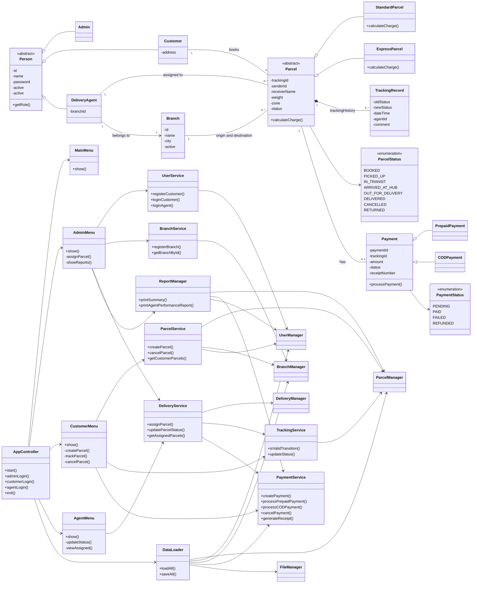

# Courier & Parcel Tracking Management System

A beginner-friendly, console-based Java application for booking parcels, tracking their status, managing branches and delivery agents, recording payments, and viewing basic reports. It uses core Java, object-oriented programming, and plain text files; it does not require a database or external libraries.

> **Project status:** This is a university learning/demo project. It is not intended for real customer data or production use. Passwords are stored as plain text in local files.

## Contents

- [Features](#features)
- [Requirements](#requirements)
- [Run the application](#run-the-application)
- [First-time walkthrough](#first-time-walkthrough)
- [Complete end-to-end workflow](#complete-end-to-end-workflow)
- [How the project achieves its objectives](#how-the-project-achieves-its-objectives)
- [Important UML class diagram](#important-uml-class-diagram)
- [Administrator login](#administrator-login)
- [Project structure](#project-structure)
- [Class responsibilities](#class-responsibilities)
- [OOP concepts demonstrated](#oop-concepts-demonstrated)
- [Parcel status transitions](#parcel-status-transitions)
- [Data files and persistence](#data-files-and-persistence)
- [Project documents](#project-documents)
- [Team work distribution](#team-work-distribution)
- [Known limitations](#known-limitations)

## Features

- Console menus for administrators, customers, and delivery agents.
- Customer registration, login, and profile updates.
- Parcel booking with generated tracking IDs, receiver details, parcel weight, delivery zone, and Standard or Express category.
- Parcel charge calculation based on category, weight, and zone.
- Parcel lookup, chronological tracking history, and cancellation before the parcel enters transit.
- Branch registration and agent registration/removal (removal deactivates the agent).
- Parcel assignment to active agents; agents can update only parcels assigned to them.
- Prepaid payments are simulated at booking; Cash on Delivery is collected when delivery is confirmed.
- Cancellation changes pending payments to failed and marks completed prepaid payments as refunded.
- Parcel, zone, service-category, revenue, and delivery-agent performance reports.
- Validation for stored text fields, finite parcel weights/charges, valid branches, and status transitions.
- Text-file persistence for users, branches, parcels, payments, and tracking history.

## Requirements

- Java Development Kit (JDK); JDK 17 or later is recommended.
- IntelliJ IDEA or another Java IDE, or a terminal.
- No third-party libraries are required.

## Run the application

### IntelliJ IDEA

1. Open the project folder in IntelliJ IDEA.
2. Set a JDK under **File → Project Structure → Project → SDK**.
3. Open `src/main/Main.java`.
4. Click the run icon beside `main`, or right-click the file and choose **Run 'Main.main()'**.
5. Use the **Run** tool window at the bottom as the console. Enter a menu number and press Enter.

The `.iml` and `.idea` files configure this project as an IntelliJ Java module. The `.vscode` files provide source and launch settings for VS Code.

### PowerShell

Run these commands from the project root:

```powershell
$files = Get-ChildItem .\src -Filter *.java -Recurse | ForEach-Object { $_.FullName }
javac -d .\out $files
java -cp .\out main.Main
```

The program is text-based: its interface appears in the IDE's Run panel or terminal, not in a separate window.

## First-time walkthrough

1. At the main menu, enter `2` to register a customer. Enter each requested value and press Enter.
2. Enter `3` to log in with the username and password you registered.
3. In the customer menu, enter `1` to book a parcel.
4. Enter receiver information, weight in kilograms, and a zone from `1` to `5`.
5. Select an origin and destination branch from the displayed branch list. A default `Main Office` branch is created if no branches are loaded.
6. Select Standard or Express, then select prepaid or Cash on Delivery. Prepaid is marked paid in the demo; COD is marked paid after an agent confirms delivery.
7. Save the displayed tracking ID. Use customer menu option `3` to look up that parcel.
8. Use option `8` in the customer menu to log out. At the main menu, choose `5` to save data and exit.

To try the administrator workflow, log in with the demo credentials below. Register an agent only after confirming that a branch exists. An agent can then log in and view parcels assigned to them.

## Complete end-to-end workflow

The complete parcel process is handled through role-based console menus. The application keeps users, branches, parcels, payments, and tracking history in memory while running and saves them to text files when the user exits through `Save data and exit`.

### 1. Application startup

1. `Main` starts `AppController`.
2. `DataLoader` loads existing users, branches, parcels, payments, and tracking records.
3. If no branch exists, `AppController` creates a default active branch named `Main Office`.
4. `MainMenu` displays the available customer, administrator, and delivery-agent actions.

### 2. Account and access setup

- A **customer** registers a name, phone, email, username, password, and address. The account becomes available for login immediately.
- An **administrator** logs in using the fixed demo credentials `admin / admin123`.
- The administrator registers branches and delivery agents. An agent must belong to an existing active branch.
- A **delivery agent** logs in and receives only the parcels assigned to their account.

Role separation is enforced in the menu and service layers: customers can access only their own parcels and payments, agents can update only assigned parcels, and administrator actions are available only after administrator login.

### 3. Parcel booking

1. The customer selects `Book a parcel`.
2. The system collects receiver name, phone, address, weight, zone, origin branch, destination branch, and parcel category.
3. `ParcelService` validates that:
   - the sender is an active customer;
   - the weight is a finite positive number;
   - the zone is from `1` to `5`;
   - both branches exist and are active;
   - the parcel category and receiver details are valid.
4. The system creates a `StandardParcel` or `ExpressParcel`, calculates the charge, and assigns a unique tracking ID.
5. The initial `BOOKED` status is recorded in chronological tracking history with the origin branch and a booking comment.

The charge is calculated by the selected parcel category using weight and zone. Standard and Express parcels implement the charge calculation through their own classes.

### 4. Payment selection

The customer chooses one of two simulated payment methods:

- **Prepaid:** the payment record is created and marked `PAID` in the demo.
- **Cash on Delivery (COD):** the payment record remains `PENDING` until the parcel is delivered.

`PaymentService` allows only one payment per parcel and exposes a receipt containing the receipt number, tracking ID, method, amount, and status.

### 5. Administrator processing and assignment

1. The administrator views branches and registered agents.
2. The parcel is assigned to an active agent whose home branch exists and is active.
3. Completed parcels cannot be assigned or reassigned.
4. The assigned agent and parcel ID are stored in the parcel record.

### 6. Delivery processing

The assigned agent selects `Update one of your assigned parcels` and chooses a valid next status.

The supported processing sequence is:

```text
BOOKED -> PICKED_UP -> IN_TRANSIT -> ARRIVED_AT_HUB
       -> OUT_FOR_DELIVERY -> DELIVERED
```

An agent can also mark an eligible parcel `RETURNED`. The customer can cancel only a `BOOKED` or `PICKED_UP` parcel.

Before changing status, `TrackingService` checks the transition table and `DeliveryService` verifies that:

- the parcel exists;
- the agent is active;
- the parcel is assigned to that agent;
- the agent's branch is active;
- the status transition is valid.

Every successful change creates a timestamped `TrackingRecord` containing the old status, new status, branch, agent ID, and comment. This provides the chronological tracking history shown to customers and assigned agents.

### 7. Delivery and COD collection

1. The agent updates the parcel to `DELIVERED`.
2. `PaymentService` validates the payment state before delivery is accepted.
3. For prepaid parcels, the payment must already be `PAID`.
4. For COD parcels, payment must be `PENDING` and is marked `PAID` automatically when delivery is confirmed.
5. The final delivery status and payment state are saved in the parcel and payment records.

### 8. Cancellation or return

- A customer can cancel a parcel only if it belongs to the customer and is in `BOOKED` or `PICKED_UP`.
- Cancellation adds a `CANCELLED` tracking record and changes the parcel to a terminal status.
- Pending COD/payment records are changed to `FAILED`.
- Completed prepaid payments are changed to `REFUNDED`.
- An agent can mark eligible transit states as `RETURNED`; `RETURNED` is terminal and cannot progress further.

### 9. Tracking, receipts, and reports

Customers can:

- list their own parcels;
- view current status;
- view complete chronological tracking history;
- view their own payment receipt;
- cancel eligible parcels.

Administrators can:

- list all parcels;
- view receipts;
- view parcel status totals;
- view Standard/Express and zone totals;
- view prepaid, COD, and total collected revenue;
- view agent assignment and delivery outcomes.

### 10. Save and reload

At the end of a session, choosing `Save data and exit` writes all in-memory changes to the text files under `data/`. At the next startup, `DataLoader` restores them. Malformed records and file errors are reported instead of silently converting them into successful operation.

## How the project achieves its objectives

| Project objective | Implementation | Result |
|---|---|---|
| Streamline parcel booking | `CustomerMenu.createParcel()` collects all booking details; `ParcelService.createParcel()` performs validation and creates either a Standard or Express parcel. | A customer receives a tracking ID and charge for a valid booking. |
| Support parcel processing | `AdminMenu.assignParcel()` assigns active agents and `DeliveryService.updateParcelStatus()` processes valid status changes. | Parcels move through controlled operational stages rather than changing status freely. |
| Manage delivery | `AgentMenu.updateStatus()` lets assigned agents update assigned parcels; delivery is limited to a valid `OUT_FOR_DELIVERY -> DELIVERED` transition. | Only authorized agents can deliver parcels assigned to them. |
| Provide chronological tracking | `TrackingService.updateStatus()` creates `TrackingRecord` entries for every valid change. | Customers and agents can inspect the parcel's history and status. |
| Manage branches and agents | `BranchService` and `UserService` register and deactivate operational accounts and branches. | Operations are organized around active branch locations and active delivery personnel. |
| Calculate charges consistently | `StandardParcel` and `ExpressParcel` implement category-specific charge logic using weight and zone. | Valid bookings receive a deterministic, visible charge. |
| Record prepaid and COD payments | `PaymentService` creates one payment per parcel and applies paid, pending, failed, and refunded states. | Both payment models follow separate lifecycle rules and provide receipts. |
| Support cancellation and return | `ParcelService.cancelParcel()` and `TrackingService` enforce eligible states and terminal status behavior. | Parcels cannot be cancelled or moved illegally after delivery processing has progressed too far. |
| Produce operational reports | `ReportManager` summarizes status, category, zone, revenue, and agent outcomes. | Administrators can review overall parcel and agent activity. |
| Preserve data between runs | `DataLoader` and `FileManager` load and atomically save text records. | Normal application exits preserve users, branches, parcels, payments, and history. |
| Protect role and data integrity | Services check ownership, active states, duplicate payments, and allowed status transitions and throw project-specific exceptions. | Invalid actions are rejected and menus show clear errors instead of silently corrupting state. |

## Important UML class diagram

This diagram summarizes the project's main structure without listing every validation, exception, manager, and utility class. It shows the important inheritance, composition, association, controller, service, and persistence relationships.

### Rendered diagram



If an SVG image is not displayed by your Markdown viewer, open the [standalone Mermaid source](./docs/courier-system-uml.mmd) or use the Mermaid diagram below.



### UML diagram relationship summary

- `Person` is the abstract base for `Admin`, `Customer`, and `DeliveryAgent`.
- `Parcel` is the abstract base for `StandardParcel` and `ExpressParcel`.
- `Payment` is the base for `PrepaidPayment` and `CODPayment`.
- `Parcel` owns its `TrackingRecord` history as composition.
- A customer may book multiple parcels, an active agent may be assigned multiple parcels, and a parcel has at most one payment record.
- `AppController` initializes and connects the menus, services, managers, and persistence layer.
- The managers hold in-memory collections, while `DataLoader` and `FileManager` provide text-file persistence.

## Administrator login

The demo administrator is created in `AppController`; it is not stored in `users.txt`.

| Username | Password |
|---|---|
| `admin` | `admin123` |

These are public demonstration credentials, not secure credentials.

## Project structure

```text
CourierManagementSystem/
├── .idea/                   IntelliJ project configuration
├── .vscode/                 VS Code Java launch/settings
├── data/                    Runtime text files (ignored by Git)
├── src/
│   ├── controller/          Console menus and user interaction
│   ├── exception/            Application-specific checked exceptions
│   ├── filehandling/         Text file reads, writes, and object loading
│   ├── main/                 Application entry point and dependency setup
│   ├── model/                User, parcel, branch, and payment objects
│   ├── service/              Business operations and in-memory managers
│   └── utility/              Input, ID, and date/time helpers
├── .gitignore
├── CourierManagementSystem.iml
└── README.md
```

## Class responsibilities

### Application entry and console controllers

| Class | Package | Responsibility |
|---|---|---|
| `Main` | `main` | Java entry point; starts `AppController`. |
| `AppController` | `main` | Creates managers and services, loads data, creates a default branch if needed, and opens the main menu. |
| `MainMenu` | `controller` | Shows the welcome instructions and routes users to administrator, customer, or agent login/registration. |
| `AdminMenu` | `controller` | Prompts an administrator to manage agents and branches, assign parcels, inspect parcels/payments, and view reports. |
| `CustomerMenu` | `controller` | Prompts a customer to book, track, view, or cancel parcels, view payments, and edit their profile. |
| `AgentMenu` | `controller` | Lets a delivery agent list assigned parcels, update statuses, and view assigned parcel histories. |

Menus collect console input and call services. They are not meant to be the source of the business rules.

### User models

| Class | Package | Responsibility |
|---|---|---|
| `Person` | `model.user` | Abstract shared user data: ID, name, contact details, login credentials, and active state. |
| `Admin` | `model.user` | Administrator identity and `ADMIN` role. |
| `Customer` | `model.user` | Customer profile, including address, and `CUSTOMER` role. |
| `DeliveryAgent` | `model.user` | Agent profile, assigned home branch, and `AGENT` role. |

### Parcel and tracking models

| Class | Package | Responsibility |
|---|---|---|
| `Parcel` | `model.parcel` | Abstract shared parcel details, status, and tracking history; declares charge and category behavior. |
| `StandardParcel` | `model.parcel` | Implements Standard parcel charge calculation. |
| `ExpressParcel` | `model.parcel` | Implements Express parcel charge calculation. |
| `ParcelCategory` | `model.parcel` | Enumerates `STANDARD` and `EXPRESS`. |
| `ParcelStatus` | `model.parcel` | Enumerates the supported parcel statuses. |
| `TrackingRecord` | `model.parcel` | Stores one status-change record with time, branch, agent, and comment. |

### Branch and payment models

| Class | Package | Responsibility |
|---|---|---|
| `Branch` | `model.branch` | Stores branch identity, location/contact information, and active state. |
| `Payment` | `model.payment` | Stores payment ID, parcel tracking ID, amount, status, date, and receipt number; provides the common payment behavior. |
| `PaymentMethod` | `model.payment` | Interface for naming and processing a payment method. |
| `PrepaidPayment` | `model.payment` | Identifies a prepaid payment and starts it as pending. |
| `CODPayment` | `model.payment` | Identifies a Cash on Delivery payment and starts it as pending. |
| `PaymentStatus` | `model.payment` | Enumerates `PENDING`, `PAID`, `FAILED`, and `REFUNDED`. |

### Services and managers

| Class | Package | Responsibility |
|---|---|---|
| `UserService` | `service.user` | Registers and authenticates customers/agents, checks the demo administrator credentials, and updates customer profiles. |
| `UserManager` | `service.user` | Holds users in memory and finds users, customers, and agents. |
| `ParcelService` | `service.parcel` | Validates parcel booking, creates the Standard/Express object, computes charges, and applies cancellation rules. |
| `ParcelManager` | `service.parcel` | Holds parcels in memory and looks them up by tracking ID, customer, agent, or status. |
| `TrackingService` | `service.parcel` | Checks allowed status transitions and adds tracking records for status updates. |
| `BranchService` | `service.branch` | Registers branches, retrieves them, and changes their active state. |
| `BranchManager` | `service.branch` | Holds branches in memory and looks them up by ID. |
| `DeliveryService` | `service.delivery` | Checks parcel and active agent before assignment; routes status updates to `TrackingService`. |
| `DeliveryManager` | `service.delivery` | Assigns parcels and lists parcels assigned to an agent. |
| `PaymentService` | `service.payment` | Creates payment records, enforces prepaid/COD lifecycle rules, handles cancellation/refunds, and builds receipts. |
| `ReportManager` | `service.report` | Summarizes statuses, zones, service categories, payment-method revenue, and agent delivery outcomes. |

### File handling, exceptions, and utilities

| Class | Package | Responsibility |
|---|---|---|
| `FileManager` | `filehandling` | Reads and writes UTF-8 text files, atomically replacing each file on save and surfacing I/O failures. |
| `DataLoader` | `filehandling` | Validates saved row shapes/references, restores model objects and ID sequence state at startup, and serializes current objects on exit. |
| `InvalidParcelException` | `exception` | Reports invalid parcel details or operations. |
| `InvalidStatusException` | `exception` | Reports missing parcels or disallowed status changes. |
| `InvalidPaymentException` | `exception` | Reports invalid or duplicate payment actions. |
| `DuplicateIdException` | `exception` | Reports duplicate user/branch registration details. |
| `RecordNotFoundException` | `exception` | Reports a missing user, branch, parcel, or payment. |
| `InputValidator` | `utility` | Reads required text and retries invalid integer/decimal input. |
| `IDGenerator` | `utility` | Generates tracking, user, branch, and payment IDs using a shared counter that resumes beyond loaded IDs. |
| `DateTimeUtility` | `utility` | Formats and parses date/time values used for display and storage. |

## OOP concepts demonstrated

| Concept | Where it appears |
|---|---|
| Encapsulation | Model fields are private and accessed through getters/setters or methods. |
| Inheritance | `Customer`, `Admin`, and `DeliveryAgent` extend `Person`; parcel types extend `Parcel`; payment types extend `Payment`. |
| Abstraction | `Person` and `Parcel` are abstract base classes that describe shared state and required behavior. |
| Polymorphism | `Parcel.calculateCharge()` and `getCategory()` resolve to the Standard or Express implementation; `getMethodName()` resolves to the payment subtype. |
| Interfaces | `PaymentMethod` defines the common payment operations implemented by `Payment` and its subclasses. |
| Method overriding | Subclasses override `getRole()`, parcel charge/category methods, and payment method naming. |
| Method overloading | Parcel charge calculation has a no-argument and a weight-unit overload. Constructors also have different parameter lists. |
| Association | Parcels store customer, branch, and delivery-agent IDs to relate the records. |
| Aggregation | Managers hold collections of independently created users, branches, parcels, and payments. |
| Composition | A parcel owns its list of `TrackingRecord` objects. |
| Exception handling | Services throw project-specific exceptions; menus catch errors and display a message. |
| File handling | `FileManager` and `DataLoader` read/write the local text files. |
| Static members | `IDGenerator` uses a shared static counter; `DateTimeUtility` exposes shared formatters and helper methods. |
| Constructors | Model objects are initialized through no-argument or parameterized constructors. |
| Getters and setters | Models expose accessors for their encapsulated fields. |

## Parcel status transitions

`TrackingService` permits the following transitions:

```text
BOOKED            -> PICKED_UP, CANCELLED
PICKED_UP          -> IN_TRANSIT, CANCELLED
IN_TRANSIT         -> ARRIVED_AT_HUB, RETURNED
ARRIVED_AT_HUB     -> OUT_FOR_DELIVERY, IN_TRANSIT
OUT_FOR_DELIVERY   -> DELIVERED, RETURNED
DELIVERED          -> no further transition
CANCELLED          -> no further transition
RETURNED           -> no further transition
```

Cancellation through the customer workflow is limited to parcels in `BOOKED` or `PICKED_UP`.

## Data files and persistence

Runtime data is stored in the `data/` directory, relative to the application's working directory:

| File | Contents |
|---|---|
| `users.txt` | Customer and delivery-agent profiles and login details. The demo admin is not stored here. |
| `branches.txt` | Branch ID, name, address, city, phone, and active state. |
| `parcels.txt` | Parcel details, status, assigned IDs, and calculated charge. |
| `tracking.txt` | Parcel status-history entries, including timestamps and comments. |
| `payments.txt` | Payment details, status, date, and receipt number. |
| `agents.txt` | Currently unused; agent records are stored in `users.txt`. |

Rows use `|` between fields, so persisted text values cannot contain that delimiter or line breaks. The application loads data at startup and saves when the user chooses **Save data and exit**. Each data file is replaced atomically; exit through the menu to save the complete current session. Malformed rows, broken parcel references, and file read/write errors are reported rather than silently ignored. The `data/*.txt` files are ignored by Git so local records are not published with source code.

## Project documents

- [`prd.md`](./prd.md) — Goals, roles, functional/non-functional requirements, scope, and acceptance criteria.
- [`architecture.md`](./architecture.md) — Package boundaries, workflows, persistence, and technical constraints.
- [`design.md`](./design.md) — Console interaction flows and experience principles.
- [`rules.md`](./rules.md) — Development and verification conventions.
- [`tasks.md`](./tasks.md) — Completed work and prioritized project backlog.
- [`memory.md`](./memory.md) — Durable project facts and working context for future contributors.

## Team work distribution

The project is divided into five end-to-end ownership areas. Each owner is responsible for the listed implementation, its validation, and coordinating any interface changes with the other owners. Difficulty indicates the relative size and complexity of the assignment.

| Owner | Difficulty | Area | Main responsibilities and project scope |
|---|---|---|---|
| **Rian** | **Hard** | Security, identity, and access control | Own user identity and authentication in `src/model/user/` and `src/service/user/`. Review role checks across the menus and services; strengthen credential handling and account access; define security-focused tests and document safe demo usage. Coordinate any persisted credential format changes with Sami. This is improvement work: the current demo uses plaintext passwords and a fixed administrator account, so do not describe it as production-secure. |
| **Sami** | **Hard-medium** | Persistence, data integrity, and shared utilities | Own `src/filehandling/`, the persisted `data/*.txt` formats, and startup/load/save behavior. Validate records and references, report file errors clearly, and maintain compatible serialization as the other areas evolve. Own shared helpers in `src/utility/` and application exceptions in `src/exception/`; coordinate changes that affect all modules. |
| **Atik** | **Medium-easy** | Parcel booking, tracking, and payments | Own parcel and tracking models in `src/model/parcel/`, payment models in `src/model/payment/`, and the parcel/tracking/payment services in `src/service/parcel/` and `src/service/payment/`. Maintain booking validation, pricing, status history and transitions, cancellation, payment lifecycles, and receipts. Coordinate persistence format changes with Sami. |
| **Imteaz** | **Medium-easy** | Branch, delivery operations, and reports | Own `src/model/branch/`, `src/service/branch/`, `src/service/delivery/`, and `src/service/report/`. Maintain branch and agent operational workflows, parcel assignment, delivery authorization and status processing, and administrative summaries. Coordinate with Rian on role/access checks and Atik on parcel/payment lifecycle rules. |
| **Sajid** | **Easy** | Console experience, application integration, and quality checks | Own `src/controller/` and application startup/wiring in `src/main/`. Keep menus and prompts consistent with the service APIs, verify the end-to-end customer/admin/agent workflows, and keep setup and usage instructions in this README accurate. Coordinate UI-facing changes with each service owner; report defects to the relevant owner rather than duplicating business rules in menus. |

### Team integration expectations

- Keep business rules in services and domain models; controllers should handle interaction and display.
- Agree on method signatures and persisted-data changes before merging dependent work. Sami should review any change to `data/*.txt` formats.
- Each owner should verify their area and provide the team with the command or steps used. Sajid coordinates a clean build and end-to-end smoke check after integration.
- Changes that cross ownership areas should be discussed with every affected owner; ownership identifies the primary coordinator, not a reason to block collaboration.

## Known limitations

- This is a local demonstration app; it has no database, encryption, or secure password storage.
- The administrator account is fixed in source code and is not configurable through the menus.
- Payment processing is simulated; there is no real payment provider or receipt document.
- Zones are simple numeric distance bands, not addresses or route calculations.
- Branch movement is represented by the parcel's current branch and tracking record; there is no routing engine.
- User and parcel data is kept in memory while the program runs and is written to text files on normal exit.
- `agents.txt` is present for the initial project layout but is not used by the current loader.
