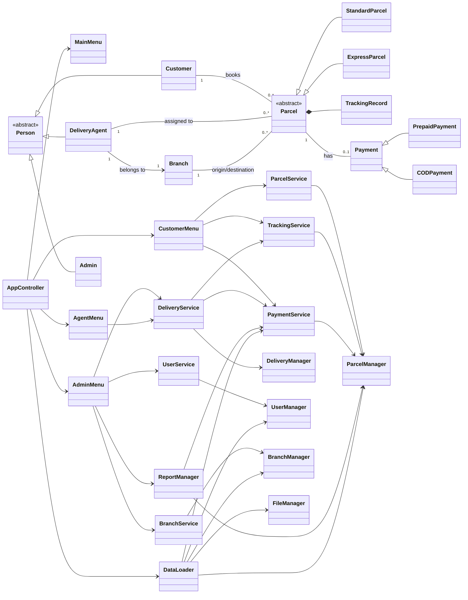

# Architecture

## Overview

The application is a single-process Java console program. `AppController` constructs the in-memory managers, domain services, loader, and menus, then coordinates startup and save-on-exit.

```text
main.Main
  └── main.AppController
       ├── controller.*Menu ──> service.*
       ├── service.* ──> model.*
       ├── service.* ──> *Manager (in-memory collections)
       └── filehandling.DataLoader ──> filehandling.FileManager ──> data/*.txt
```

## Important UML class diagram

The complete, presentation-size diagram is maintained in [`README.md`](./README.md#important-uml-class-diagram).
It includes the key models, role classes, parcel and payment subclasses, core services, managers, persistence classes, and console controllers while omitting repetitive utility and exception classes.





## Package responsibilities

- `main/` — Application entry point and dependency wiring.
- `controller/` — Console menus, input collection, and user-facing messages.
- `service/` — Business rules for user, branch, parcel, tracking, delivery, payment, and reports.
- `model/` — Domain entities, enums, and interfaces.
- `filehandling/` — UTF-8 text-file operations and serialization/deserialization.
- `exception/` — Application-specific checked exceptions.
- `utility/` — Input validation, IDs, and date/time formatting.

## Key flows

### Startup

1. `Main` starts `AppController`.
2. `DataLoader.loadAll` reads users and branches, validates agent/branch references, then loads parcels, tracking, and payments.
3. A default branch is created only when none are loaded.
4. `MainMenu` starts the console interaction loop.

### Booking

`CustomerMenu` gathers inputs → `ParcelService` validates customer, fields, branches, weight, zone, and category → a `Parcel` subtype calculates its charge → the parcel and initial tracking record are stored in memory → `PaymentService` creates the selected payment.

### Delivery

Administrator assigns an active parcel to an active agent → agent requests a status transition → `DeliveryService` verifies assignment, active status, and branch → `TrackingService` checks the transition and records it → delivery confirmation validates payment and collects COD when applicable.

### Save

`AppController.exit` calls `DataLoader.saveAll`. `FileManager` writes each file to a temporary file and replaces that individual file atomically. The five-file save is not a single transaction.

## Data and persistence

| File | Primary records |
|---|---|
| `data/users.txt` | Customer and agent profiles |
| `data/branches.txt` | Branches and active state |
| `data/parcels.txt` | Parcel details and current state |
| `data/tracking.txt` | Chronological status history |
| `data/payments.txt` | Payment method, state, amount, and receipt |

Rows are pipe-delimited. Persisted text fields cannot include `|` or line breaks. `DataLoader` validates field counts and references; malformed rows are reported with file and line.

## Design constraints and known limitations

- Managers are in-memory lists and are not thread-safe; this application is single-user.
- File persistence is appropriate only for a local demonstration, not concurrent or production use.
- Payment operations are simulated; there is no external payment provider.
- User passwords are currently stored in plaintext.
- Delivery branch movement is represented by status records and current-branch IDs; no route engine exists.

## Build and launch

- Source root: `src/`.
- Main class: `main.Main`.
- VS Code output path: `out/`.
- IntelliJ module output: `out/production/CourierManagementSystem`.
- PowerShell compilation and launch commands are in `README.md`.
